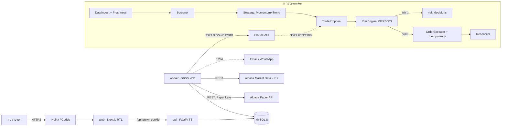

# VIBIT AI Trader — שלב א: ארכיטקטורה

> מערכת מחקר ומסחר מדומה (Paper Trading) בלבד. שום דבר כאן אינו ייעוץ השקעות, ואין הבטחה לרווח.
> היעד של $100 בחודש (10% מ-$1,000) הוא **השערה לבדיקה**, לא תחזית. רוב האסטרטגיות הפשוטות לא מגיעות לזה באופן עקבי אחרי עלויות.

## 1. עקרונות מנחים

| עיקרון | איך נאכף בקוד |
|---|---|
| Paper בלבד | `paperGuard.ts`: ה-API וה-Worker מסרבים לעלות אם `TRADING_MODE≠paper` או אם כתובת הברוקר אינה `https://paper-api.alpaca.markets`. נבדק ב-Unit Tests. |
| הבוט רץ גם כשהדפדפן סגור | תהליך `worker` נפרד ב-Docker (`restart: unless-stopped`). |
| Claude לא מאשר עסקאות | Claude מחזיר JSON מנותח בלבד. רק `RiskEngine` (קוד דטרמיניסטי) יכול להעביר הצעה ל-`OrderExecutor`. ל-Claude אין גישה לכלים, למפתחות או ל-DB. |
| מצב בטוח כברירת מחדל | בכל הפעלה של ה-Worker מצב הבוט נקבע ל-`SAFE` (לא פותח עסקאות) עד אישור ידני. |
| Kill Switch | דגל ב-DB שנבדק לפני כל שליחת פקודה; הפעלה מהממשק או אוטומטית בהפסד 5%. |
| שקיפות | כל החלטה (כולל דחייה) נשמרת ב-`risk_decisions` / `audit_log`. |

## 2. תרשים רכיבים

## 3. החלטות טכנולוגיה (ומה **לא** צריך)

| רכיב | החלטה | נימוק |
|---|---|---|
| Frontend | Next.js 14 + TypeScript, RTL | כמבוקש. גוף ה-API מוסתר מאחורי rewrite כך שהעוגייה נשארת same-origin. |
| API | Fastify + TypeScript | קל, מהיר, rate-limit ו-cookies מובנים. |
| Worker | אותו קוד TS, entry נפרד (`worker.ts`) | חולק לוגיקה עם ה-API בלי שירות נוסף. |
| DB | MySQL 8, מיגרציות SQL פשוטות | מוכר לך; אין ORM כבד. |
| Redis / BullMQ | **לא בשלב זה** | יש worker יחיד ועשרות פעולות ביום. נעילה + תור דרך MySQL (`SELECT … FOR UPDATE`, מפתחות ייחודיים) מספיקים. נוסיף Redis רק אם נגיע לכמה workers. |
| Python | **רק בשלב ו** | ל-Backtesting (pandas/vectorbt). מנוע החי ב-TS כדי שתהיה רק לוגיקה אחת. ה-Backtest יאמת את אותם חוקים מול אותם נתונים. |
| Docker Compose | dev + prod | `mysql`, `api`, `worker`, `web`. |
| UPRESS | מתאים ל-web בלבד אם יש Node; ה-worker דורש תהליך רציף → **VPS Linux מומלץ** (DigitalOcean/Hetzner). | אחסון משותף לא מבטיח תהליך שרץ 24/7. |

## 4. מסד נתונים (ראו `apps/api/src/db/migrations`)

| טבלה | תפקיד |
|---|---|
| `users`, `sessions` | משתמשים, סשנים (טוקן מגובב SHA-256, httpOnly) |
| `secrets` | מפתחות API מוצפנים AES-256-GCM (מפתח-אב מ-ENV בלבד) |
| `settings` | הגדרות משתמש (שער ILS ידני, התראות, שעות פעילות) |
| `bot_state` | שורה אחת: מצב (`SAFE/ACTIVE/HALTED`), Kill Switch, heartbeat |
| `risk_limits` | גרסאות ספי סיכון (רק אדם משנה; כל שינוי מתועד) |
| `account_snapshots` | שווי תיק לאורך זמן (`source = demo/alpaca`) |
| `positions`, `orders`, `fills` | מראה של מצב הברוקר + מזהי Alpaca + `client_order_id` ייחודי |
| `trade_proposals` | הצעת עסקה מובנית: Symbol, Side, Qty, PriceRef, Stop, Rationale, Strategy Version |
| `risk_decisions` | כל בדיקה: אושר/נדחה + אילו חוקים נכשלו |
| `ai_analyses` | Prompt Version, Model, hash של נתוני קלט, JSON תוצאה, עלות |
| `audit_log` | כל פעולה רגישה (התחברות, Kill Switch, שינוי מפתח) |

כל שורה עם `source='demo'` מוצגת בממשק בתג **DEMO** ולעולם לא נכנסת לחישובי ביצועים אמיתיים.

## 5. כללי סיכון ראשוניים (שמרניים, לחשבון $1,000)

| כלל | ערך | נימוק |
|---|---|---|
| הון בסיס לחישוב | $1,000 (גם אם חשבון ה-Paper גדול יותר) | Alpaca פותחת Paper ב-$100k כברירת מחדל; המנוע משתמש ב-`min(equity, CAPITAL_BASE)`. מומלץ ליצור חשבון Paper של $1,000. |
| סיכון מתוכנן לעסקה | 1% = $10 | כמות = ⌊$10 / (כניסה − סטופ)⌋. **לא גבול הפסד** — Gap יכול לדלג מעל הסטופ. |
| גודל פוזיציה מקס' | 20% = $200 | מניעת ריכוזיות. |
| חשיפה כוללת מקס' | 60% = $600 | כרית מזומן ומניעת "הכל בבת אחת". |
| פוזיציות פתוחות מקס' | 3 | |
| הפסד יומי | 2% = $20 → אין עסקאות חדשות עד מחר | |
| Kill Switch | שווי ≤ $950 (‎-5%) → HALTED | דורש אישור ידני לחזרה. |
| מחיר מניה מינ' | $5 | מניות זולות = מרווחים ותנודות קיצוניים. |
| נזילות | ממוצע מחזור דולרי יומי ≥ $20M | |
| Spread מקס' | 0.15% | |
| עדכניות נתונים | ציטוט ≤ 60 שניות, נר יומי מהיום האחרון | אחרת — אין מסחר. |
| חלון זמן | לא ב-15 הדקות הראשונות/אחרונות | תנודתיות פתיחה/סגירה. |
| ללא | מינוף, שורט, אופציות, קריפטו, Extended Hours | |

### מגבלות שמצאתי לחשבון קטן (לא עוקפים — מדווחים)
1. **מניות שלמות בלבד בגרסה 1.** לפי התיעוד, פקודות חלקיות (fractional) נתמכות רק ב-`time_in_force=day` ואינן תומכות ב-Bracket/OTO. כלומר סטופ אצל הברוקר לא ישרוד ללילה. לכן: כמות שלמה + Bracket/OTO עם `gtc`. אם הסיכון של $10 מוביל לכמות < 1 → העסקה **נדחית** עם הסבר. בפועל זה מעדיף ETF/מניות במחיר נמוך-בינוני.
2. **PDT:** ה-SEC אישרה ב-14.4.2026 לבטל את כלל ה-$25,000; הכלל נכנס לתוקף ב-4.6.2026, וברוקרים רשאים ליישם עד 20.10.2027. לא אימתתי מתי Alpaca מיישמת זאת, ו-Paper מדמה בדיקות PDT. האסטרטגיה הבסיסית היא Swing (ימים–שבועות), לא Day Trading, ולכן כמעט לא מושפעת. נבדוק מול `/v2/account` (`pattern_day_trader`, `daytrade_count`) בשלב ג.
3. **נתוני שוק:** חשבון Paper מקבל IEX בלבד (חלק קטן מהמחזור). מחירי IEX עלולים לסטות מה"מחיר האמיתי" ולהציג Spread מעוות → הפילטר מחמיר ומסמן נתון חשוד.
4. **סימולציה אופטימית:** Paper ממלא פקודות בצורה חלקית רק ~10% מהזמן ולא מדמה דיבידנדים. Slippage אמיתי גבוה יותר — ה-Backtest יוסיף עלויות מפורשות.

## 6. סיכונים מרכזיים (חובה להבין)

| סיכון | מה זה | הטיפול |
|---|---|---|
| Gap | המניה נפתחת מתחת לסטופ — ההפסד גדול מ-$10 | גודל פוזיציה מקס', חשיפה כוללת, אין החזקה סביב דוחות (שלב ד). |
| Slippage | ביצוע במחיר גרוע מהציפייה | Limit orders, פילטר Spread, עלויות ב-Backtest. |
| נזילות | אין קונים ביציאה | פילטר מחזור. |
| תקלה/ניתוק | Worker נופל עם פוזיציה פתוחה | הסטופ יושב **אצל הברוקר** (GTC), לא רק בזיכרון; Reconciler ומצב SAFE בעלייה. |
| פקודה כפולה | Retry אחרי Timeout | `client_order_id` דטרמיניסטי + UNIQUE ב-DB + שאילתה לפי client id לפני שליחה חוזרת. |
| Overfitting | אסטרטגיה "מנצחת" רק על העבר | Train/Validation/Test, Walk-Forward, השוואה ל-SPY. |
| Prompt Injection | חדשות עם הוראות זדוניות | Claude מקבל נתונים מספריים מאומתים בעיקר; טקסט חיצוני עטוף ומסומן כ"נתון"; פלט עובר Zod; אין לו יכולת פעולה. |
| דליפת מפתחות | | ENV/הצפנה, אף פעם לא לדפדפן/לוג/Git, `.gitignore`, מסכה בלוגים. |

## 7. תוכנית מימוש ותנאי קבלה

| שלב | תוצר | תנאי קבלה |
|---|---|---|
| **א** | המסמך הזה | אושר |
| **ב** | Monorepo, Docker, MySQL, התחברות, Dashboard עם Demo, Kill Switch, Worker במצב SAFE | `docker compose up` עולה; התחברות עובדת; Dashboard מציג DEMO; Kill Switch משנה מצב; בדיקות עוברות |
| ג | AlpacaClient (Paper), סנכרון חשבון/פוזיציות/פקודות, Clock API | מצב חיבור אמיתי; snapshot אמיתי בגרף; ניתוק → אין מסחר |
| ד | Screener, Momentum+Trend, RiskEngine, Executor, Reconciler, MockBroker | בדיקות לכל חוק סיכון; פקודה כפולה נחסמת; Partial fill מטופל |
| ה | Claude: ניתוח מובנה + הסבר לכל עסקה | Schema validation; תיעוד prompt/model; מגבלת עלות יומית |
| ו | Python backtest, Walk-Forward, דוחות | ללא Look-ahead; השוואה ל-SPY; עלויות |
| ז | פריסה ל-VPS, HTTPS, גיבויים, ניטור, התראות | רץ 30+ יום ב-Paper עם דוח שבועי |
